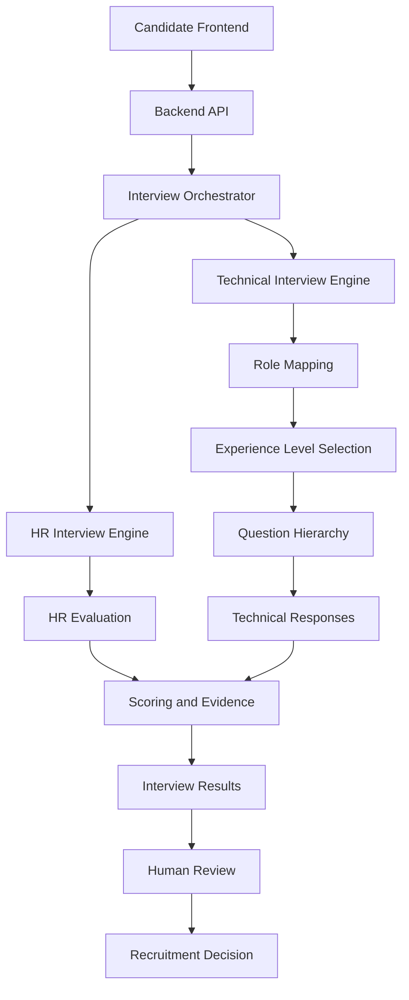

# Day 44 - HR and Technical Interview Architecture

## Objective
Prepare the HR Interview AI for integration and maintenance.

## Architecture

## Main Components
| Component | Responsibility |
|---|---|
| API | Accept interview requests |
| Orchestrator | Coordinates interview stages |
| HR engine | Structures HR evaluation |
| Technical engine | Selects role-based questions |
| Role mapping | Maps roles to skill domains |
| Experience logic | Selects question level |
| Question hierarchy | Organizes question categories |
| Scoring | Calculates weighted demonstration scores |
| Human review | Supports authorized final decision |

## Data Formats
Candidate: candidate_id, candidate_name, role, experience_years.
Technical blueprint: role, experience_level, skill_domains, sections, questions.
HR evaluation: candidate details, component scores, weighted score, recommendation, manager feedback.

## Developer Integration
1. Validate candidate and role details.
2. Generate an interview blueprint.
3. Conduct the interview.
4. Store answers and evidence.
5. Evaluate using approved criteria.
6. Return results to the backend.
7. Route results to an authorized human reviewer.

## Troubleshooting
| Problem | Cause | Action |
|---|---|---|
| Unsupported role | Role not mapped | Use MERN, Java or DevOps |
| Negative experience | Invalid input | Validate experience |
| Missing candidate ID | Required field absent | Supply candidate ID |
| Invalid score | Outside 0-100 | Validate score range |
| Invalid JSON | Malformed request | Correct JSON body |
| API unavailable | Server stopped | Start API module |

## Production considerations
Authentication, authorization, HTTPS, secure storage, audit logs, consent and retention controls, monitoring, database persistence and HR validation are required before production deployment.