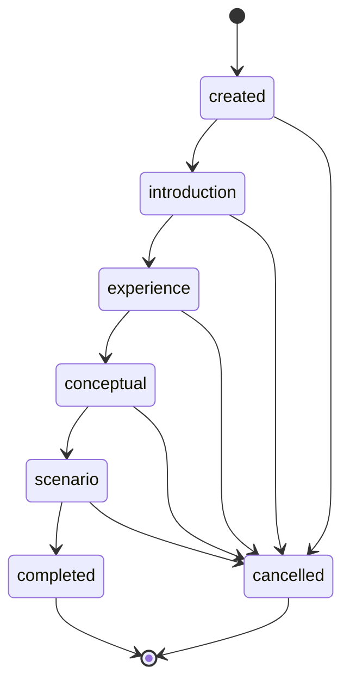
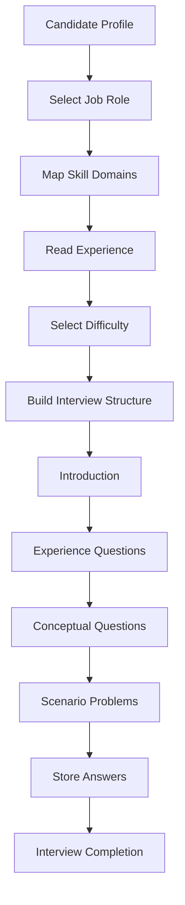

# Day 46 - Technical Interview AI Blueprint

## Objective
Design a scalable AI system capable of conducting role-based technical interviews.

## Interview structure
1. Introduction
2. Experience-based questions
3. Conceptual questions
4. Scenario-based problems

## Experience-based logic
| Experience | Level | Focus |
|---|---|---|
| 0-2 years | Basic | Fundamentals |
| 3 to less than 5 years | Intermediate | Practical application |
| 5+ years | Advanced | Advanced concepts and system design |

The implementation maps 0-2 years to basic, 3 to less than 5 years to intermediate, and 5+ years to advanced. This resolves the overlap at exactly 5 years by following the explicit 5+ advanced requirement.

## Role to skill mapping
| Role | Skill domains |
|---|---|
| MERN | JavaScript, React, Node.js, Express, MongoDB, REST APIs |
| Java | Java, OOP, Spring Boot, Hibernate, SQL, REST APIs |
| DevOps | Linux, Git, Docker, CI/CD, Kubernetes, Cloud |

## Question hierarchy
```text
Technical Interview
|-- Introduction
|-- Experience
|-- Conceptual
|   |-- Basic
|   |-- Intermediate
|   `-- Advanced
`-- Scenario
    |-- Basic
    |-- Intermediate
    `-- Advanced
```

## Interview flow states
created -> introduction -> experience -> conceptual -> scenario -> completed.
Cancellation is permitted from each active state.

## State transition diagram


## Interview workflow


## Scope limitation
This implementation generates role-based interview blueprints and manages interview states. It does not implement live voice interviewing, automatic code execution, adaptive question selection based on answer quality or a validated technical answer-scoring model.